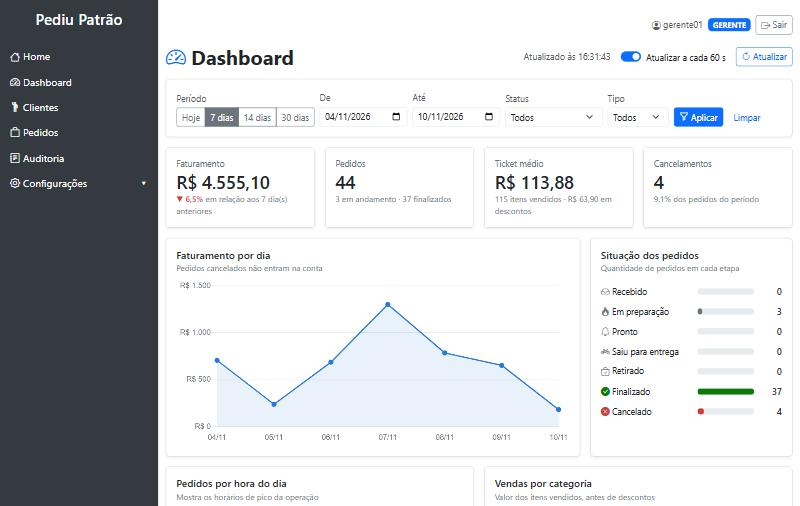
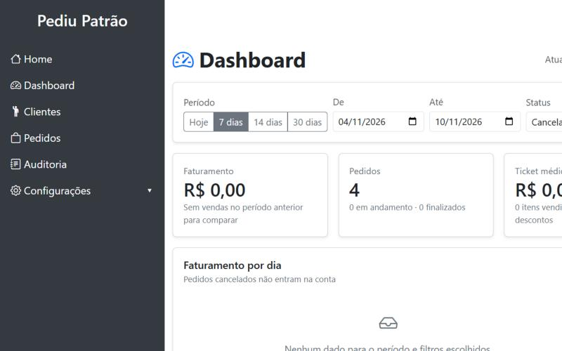
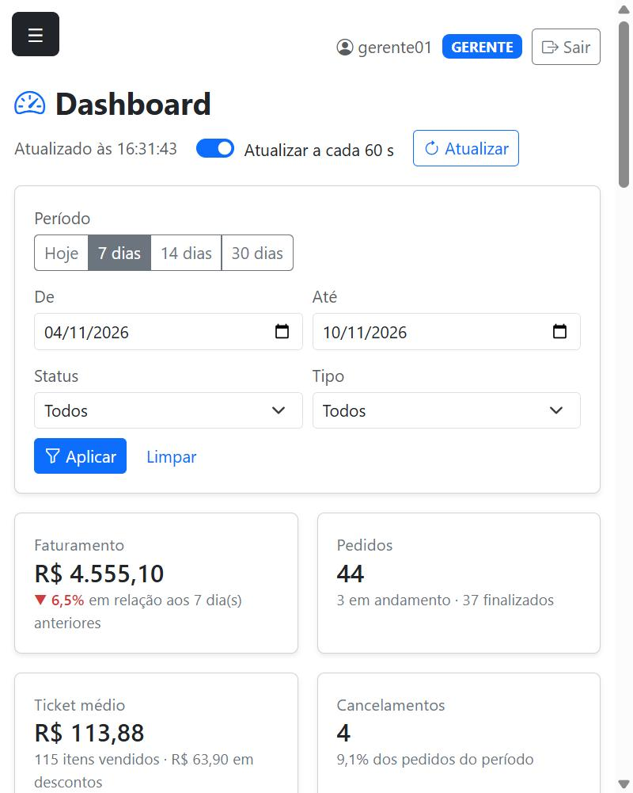

# Dashboard Administrativo — Pediu Patrão

Documento de entrega da atividade: requisitos, documentação da API, evidências de testes
e principais decisões de análise e projeto.

- **Tela:** `http://localhost:8080/dashboard` (perfis ADMIN e GERENTE)
- **API:** `http://localhost:8080/api/dashboard/**`
- **Branch da implementação:** `feature/dashboard-administrativo` (gitflow, criada a partir de `develop`)

## Sumário

1. [Visão geral](#1-visão-geral)
2. [Requisitos funcionais](#2-requisitos-funcionais)
3. [Requisitos não funcionais](#3-requisitos-não-funcionais)
4. [Regras de negócio](#4-regras-de-negócio)
5. [Modelagem de dados](#5-modelagem-de-dados)
6. [Documentação dos endpoints](#6-documentação-dos-endpoints)
7. [Evidências de testes](#7-evidências-de-testes)
8. [Decisões de análise e projeto](#8-decisões-de-análise-e-projeto)
9. [Como executar](#9-como-executar)

---

## 1. Visão geral

O dashboard permite que o responsável pela pizzaria acompanhe as vendas, veja a situação dos
pedidos e identifique tendências (dias e horários de maior movimento, produtos que mais saem,
comparação com o período anterior).

```
Navegador (dashboard.html + dashboard.js + Chart.js)
        │  fetch GET /api/dashboard/...   (JSON, sessão do login)
        ▼
DashboardController  →  DashboardService  →  PedidoRepository / ProdutoRepository  →  MongoDB
   (HTTP, parâmetros)     (regras e contas)        (consulta por período)
```

A tela é entregue vazia pelo Thymeleaf e **todos os dados vêm da API**. Cada bloco da tela
(indicadores, cada gráfico, cada tabela) consome um endpoint próprio.

Arquivos da implementação:

| Camada | Arquivo |
|---|---|
| Controller (API) | `controller/DashboardController.java` |
| Serviço (regras) | `service/DashboardService.java` |
| Filtros e validação | `dto/FiltroDashboard.java` |
| Respostas da API | `dto/DashboardDTO.java` |
| Consulta no banco | `repository/PedidoRepository.java` (`buscarPorPeriodo`) |
| Tratamento de erros | `exception/TratamentoErros.java` |
| Segurança | `config/SecurityConfig.java` |
| Tela | `templates/dashboard.html`, `static/js/dashboard.js`, `static/css/dashboard.css` |
| Dados de demonstração | `config/DemoDataSeeder.java` |
| Testes | `DashboardServiceTest.java`, `DashboardApiTest.java` |

---

## 2. Requisitos funcionais

| ID | Requisito | Como foi atendido | Endpoint |
|---|---|---|---|
| **RF01** | Indicadores gerais de vendas | Quatro indicadores no topo: faturamento (com variação em relação ao período anterior), total de pedidos (em andamento e finalizados), ticket médio (com itens vendidos e descontos) e cancelamentos (quantidade e taxa) | `GET /indicadores` |
| **RF02** | Análise de vendas (gráficos) | Faturamento por dia (linha), pedidos por hora do dia (barras, mostra o horário de pico) e vendas por categoria de produto (barras horizontais) | `GET /vendas-por-dia`, `/vendas-por-hora`, `/vendas-por-categoria` |
| **RF03** | Situação dos pedidos | Quantidade de pedidos em cada etapa do fluxo (Recebido → … → Finalizado / Cancelado) e lista dos pedidos mais recentes com link para o detalhe | `GET /pedidos-por-status`, `/pedidos-recentes` |
| **RF04** | Produtos mais vendidos | Ranking por quantidade vendida, com categoria, valor e participação; tamanho configurável (Top 5, 10 ou 20) | `GET /produtos-mais-vendidos` |
| **RF05** | Filtros de consulta | Período (atalhos Hoje / 7 / 14 / 30 dias ou datas livres), status do pedido e tipo de entrega. Os filtros valem para a página inteira e são enviados a todos os endpoints | `GET /filtros` + parâmetros em todos os endpoints |
| **RF06** | Integração com a API | A tela não recebe dados do servidor no HTML: tudo é buscado com `fetch` em `/api/dashboard/**`, em chamadas paralelas e independentes | todos |
| **RF07** | Atualização e tratamento de dados | Botão **Atualizar**, atualização automática a cada 60 s (pausa com a aba oculta), horário da última atualização, e estados de *carregando*, *sem dados* e *erro* (com "Tentar de novo") em cada bloco. Respostas antigas são descartadas quando o filtro muda rápido | todos |

Detalhes do RF07 (tratamento de dados):

- **Sem dados:** período sem pedidos devolve zeros e listas vazias (nunca erro); a tela mostra "Nenhum dado para o período e filtros escolhidos".
- **Falha parcial:** se um endpoint falhar, só o bloco dele mostra erro; o resto continua funcionando.
- **Filtro inválido:** validado na tela antes de chamar a API e validado de novo na API (400 com mensagem).
- **Sessão expirada (401):** a tela redireciona para o login.
- **Dados incompletos no banco:** pedido sem data de entrada, sem itens ou com status antigo não derruba o dashboard.
- **Dias sem venda:** aparecem com zero no gráfico por dia, para a linha não "pular" datas.

---

## 3. Requisitos não funcionais

| ID | Categoria | Requisito |
|---|---|---|
| **RNF01** | Segurança | Acesso à tela e à API somente para usuários autenticados com perfil **ADMIN** ou **GERENTE**. Sem login a API responde 401; com outro perfil, 403. A regra é aplicada no backend em dois níveis (`SecurityConfig` por URL e `@PreAuthorize` no serviço), não só escondendo o menu. |
| **RNF02** | Segurança | A API do dashboard é **somente leitura**: só aceita `GET`; qualquer outro método é negado. |
| **RNF03** | Segurança | A API devolve DTOs próprios, só com os campos necessários (não expõe a entidade `Pedido` inteira). Nomes de clientes e produtos são inseridos na tela com `textContent`, evitando injeção de HTML (XSS). |
| **RNF04** | Padronização | Respostas em JSON. Datas no padrão ISO-8601 (`AAAA-MM-DD`), valores monetários como número com 2 casas. Todo erro tem o mesmo formato: `{"erro": "mensagem"}`. |
| **RNF05** | Desempenho | Cada consulta busca no MongoDB apenas os pedidos do período pedido. O período é limitado a 366 dias e o ranking a 50 itens, para a resposta não crescer sem controle. |
| **RNF06** | Confiabilidade | Falha de banco responde 503 com mensagem amigável; a tela trata falha por bloco e permite tentar de novo. |
| **RNF07** | Usabilidade | Layout responsivo (computador e celular), valores no formato brasileiro (R$ e datas dd/mm), status sempre com ícone + texto (não depende só de cor), detalhes ao passar o mouse nos gráficos. |
| **RNF08** | Manutenibilidade | Mantidas as camadas do projeto (controller → service → repository). As regras de cálculo ficam todas no `DashboardService` e a validação dos filtros em um único lugar (`FiltroDashboard`). |
| **RNF09** | Testabilidade | Regras cobertas por testes automatizados que não dependem do MongoDB (29 testes novos; 51 no total). |
| **RNF10** | Compatibilidade | Java 21, Spring Boot 3.4, MongoDB. Nenhuma dependência nova foi adicionada: os gráficos usam o Chart.js 2.9 que já estava em `static/plugins`. |

---

## 4. Regras de negócio

| ID | Regra |
|---|---|
| **RN01** | **Pedido cancelado não é venda.** Ele conta no total de pedidos, na taxa de cancelamento e na situação dos pedidos, mas fica fora do faturamento, do ticket médio, dos gráficos de venda e do ranking de produtos. |
| **RN02** | O período é aplicado sobre a **data/hora de entrada** do pedido. `dataInicio` e `dataFim` são inclusivos (o dia final conta inteiro). |
| **RN03** | Sem datas informadas, o período é o dos **últimos 7 dias**, contando hoje. |
| **RN04** | Faturamento = soma do `valorTotal` (já com desconto) dos pedidos não cancelados. |
| **RN05** | Ticket médio = faturamento ÷ pedidos não cancelados (0 quando não há pedidos). |
| **RN06** | Taxa de cancelamento = cancelados ÷ total de pedidos do período × 100. |
| **RN07** | Variação do faturamento = comparação com o período imediatamente anterior e de mesmo tamanho. Se o período anterior não teve vendas, a variação é `null` (não dá para dividir por zero). |
| **RN08** | Vendas por categoria e ranking usam o valor dos **itens** (antes do desconto), porque o desconto é do pedido e não de um item específico. |
| **RN09** | Ranking de produtos ordenado por quantidade vendida; em caso de empate, maior valor vendido e depois nome. |
| **RN10** | Produto que não existe mais no cadastro (ou sem tipo) aparece na categoria "Sem categoria". |

---

## 5. Modelagem de dados

O dashboard **não cria coleções novas**: ele lê as coleções que o sistema de pedidos já grava.

```
pedidos (Pedido)                                   produtos (Produto)
├─ id                                              ├─ id
├─ clienteId, clienteNome                          ├─ nome
├─ tipoEntrega        ENTREGA | RETIRADA           ├─ tipo  (Pizza, Bebida...)  ← categoria
├─ status             RECEBIDO ... CANCELADO       ├─ preco
├─ dataHoraEntrada    ← base do filtro de período  └─ ativo
├─ subtotal, percentualDesconto,
│  valorDesconto, valorTotal
└─ itens[] (ItemPedido, embutido)
   ├─ produtoId  ───────────────────────────────►  produtos.id
   ├─ nomeProduto, quantidade
   └─ precoUnitario, subtotal
```

| Dado do dashboard | Origem |
|---|---|
| Faturamento, ticket médio, descontos | `pedidos.valorTotal`, `pedidos.valorDesconto` |
| Vendas por dia / por hora | `pedidos.dataHoraEntrada` |
| Situação dos pedidos | `pedidos.status` |
| Produtos mais vendidos | `pedidos.itens[].quantidade` e `.subtotal` |
| Categoria | `produtos.tipo` (ligado por `itens[].produtoId`) |

Consulta usada no banco (em `PedidoRepository`):

```java
@Query("{ 'dataHoraEntrada': { $gte: ?0, $lt: ?1 } }")
List<Pedido> buscarPorPeriodo(LocalDateTime inicio, LocalDateTime fim);
```

---

## 6. Documentação dos endpoints

**Base:** `/api/dashboard` · **Método:** somente `GET` · **Formato:** JSON
**Autenticação:** sessão do login (cookie `JSESSIONID`) · **Perfis:** ADMIN e GERENTE

| Endpoint | Para que serve | RF |
|---|---|---|
| `GET /api/dashboard/filtros` | Opções para montar os filtros da tela | RF05 |
| `GET /api/dashboard/indicadores` | Indicadores gerais | RF01 |
| `GET /api/dashboard/vendas-por-dia` | Série diária de pedidos e faturamento | RF02 |
| `GET /api/dashboard/vendas-por-hora` | Pedidos e faturamento por hora do dia | RF02 |
| `GET /api/dashboard/vendas-por-categoria` | Vendas por tipo de produto | RF02 |
| `GET /api/dashboard/pedidos-por-status` | Quantidade de pedidos em cada status | RF03 |
| `GET /api/dashboard/pedidos-recentes` | Últimos pedidos do período | RF03 |
| `GET /api/dashboard/produtos-mais-vendidos` | Ranking de produtos | RF04 |

### 6.1 Parâmetros comuns (filtros)

Aceitos por todos os endpoints, menos `/filtros`. Todos são opcionais.

| Parâmetro | Tipo | Padrão | Descrição |
|---|---|---|---|
| `dataInicio` | data `AAAA-MM-DD` | 6 dias antes de `dataFim` | Primeiro dia do período (inclusivo) |
| `dataFim` | data `AAAA-MM-DD` | hoje | Último dia do período (inclusivo) |
| `status` | texto | todos | `RECEBIDO`, `EM_PREPARACAO`, `PRONTO`, `SAIU_PARA_ENTREGA`, `RETIRADO`, `FINALIZADO` ou `CANCELADO` |
| `tipoEntrega` | texto | todos | `ENTREGA` ou `RETIRADA` |

`status` e `tipoEntrega` aceitam maiúsculas ou minúsculas. O período máximo é de 366 dias.

### 6.2 Erros (iguais para todos os endpoints)

| HTTP | Quando acontece | Corpo |
|---|---|---|
| **400** | Data fora do formato `AAAA-MM-DD` | `{"erro": "Parâmetro dataInicio inválido. Use o formato AAAA-MM-DD (ex: 2026-11-10)."}` |
| **400** | `dataInicio` maior que `dataFim` | `{"erro": "A data inicial não pode ser maior que a data final."}` |
| **400** | Período maior que 366 dias | `{"erro": "O período máximo de consulta é de 366 dias."}` |
| **400** | `status` desconhecido | `{"erro": "Status inválido. Use um destes: RECEBIDO, EM_PREPARACAO, ..."}` |
| **400** | `tipoEntrega` desconhecido | `{"erro": "Tipo de entrega inválido. Use ENTREGA ou RETIRADA."}` |
| **400** | `limite` fora de 1 a 50 | `{"erro": "O parâmetro limite deve estar entre 1 e 50."}` |
| **400** | `limite` que não é número | `{"erro": "Parâmetro limite inválido."}` |
| **401** | Sem login ou sessão expirada | sem corpo |
| **403** | Perfil sem permissão (ATENDENTE) ou método diferente de GET | página/JSON padrão de acesso negado |
| **503** | Banco de dados indisponível | `{"erro": "Não foi possível consultar o banco de dados. Tente novamente em instantes."}` |

### 6.3 `GET /api/dashboard/filtros`

Sem parâmetros. Devolve as opções válidas e o período padrão.

```
GET /api/dashboard/filtros
```

```json
{
  "status": ["RECEBIDO", "EM_PREPARACAO", "PRONTO", "SAIU_PARA_ENTREGA", "RETIRADO", "FINALIZADO", "CANCELADO"],
  "tiposEntrega": ["ENTREGA", "RETIRADA"],
  "dataInicioPadrao": "2026-11-04",
  "dataFimPadrao": "2026-11-10",
  "periodoMaximoDias": 366
}
```

### 6.4 `GET /api/dashboard/indicadores`

Parâmetros: filtros comuns.

```
GET /api/dashboard/indicadores?dataInicio=2026-11-04&dataFim=2026-11-10
```

```json
{
  "periodo": { "dataInicio": "2026-11-04", "dataFim": "2026-11-10", "dias": 7 },
  "totalPedidos": 44,
  "pedidosValidos": 40,
  "pedidosEmAndamento": 3,
  "pedidosFinalizados": 37,
  "pedidosCancelados": 4,
  "taxaCancelamento": 9.09,
  "faturamento": 4555.1,
  "ticketMedio": 113.88,
  "totalDescontos": 63.9,
  "itensVendidos": 115,
  "faturamentoPeriodoAnterior": 4872.25,
  "pedidosPeriodoAnterior": 39,
  "variacaoFaturamento": -6.51,
  "atualizadoEm": "2026-11-10T16:30:20.3842215"
}
```

| Campo | Descrição |
|---|---|
| `periodo` | Período realmente aplicado (útil quando as datas não foram enviadas) |
| `totalPedidos` | Todos os pedidos do período, inclusive cancelados |
| `pedidosValidos` | Pedidos não cancelados |
| `pedidosEmAndamento` | Não cancelados e ainda não finalizados |
| `taxaCancelamento` | Percentual de cancelados sobre o total |
| `faturamento` | Soma do valor total dos pedidos não cancelados |
| `ticketMedio` | Faturamento ÷ pedidos válidos |
| `totalDescontos` | Soma dos descontos concedidos |
| `itensVendidos` | Soma das quantidades dos itens |
| `faturamentoPeriodoAnterior`, `pedidosPeriodoAnterior` | Mesmos números no período anterior de mesmo tamanho |
| `variacaoFaturamento` | Variação percentual contra o período anterior; `null` se o anterior não teve vendas |
| `atualizadoEm` | Momento em que o servidor calculou os dados |

### 6.5 `GET /api/dashboard/vendas-por-dia`

Parâmetros: filtros comuns. Devolve **um item por dia do período**, inclusive dias sem venda.

```
GET /api/dashboard/vendas-por-dia?dataInicio=2026-11-08&dataFim=2026-11-10
```

```json
[
  { "data": "2026-11-08", "pedidos": 8, "faturamento": 785.4 },
  { "data": "2026-11-09", "pedidos": 5, "faturamento": 653.5 },
  { "data": "2026-11-10", "pedidos": 3, "faturamento": 182.0 }
]
```

### 6.6 `GET /api/dashboard/vendas-por-hora`

Parâmetros: filtros comuns. Devolve sempre **24 itens** (horas 0 a 23).

```
GET /api/dashboard/vendas-por-hora
```

```json
[
  { "hora": 0, "pedidos": 0, "faturamento": 0.0 },
  { "hora": 19, "pedidos": 7, "faturamento": 774.2 },
  { "hora": 23, "pedidos": 3, "faturamento": 449.5 }
]
```

*(exemplo resumido: a resposta real traz as 24 horas)*

### 6.7 `GET /api/dashboard/vendas-por-categoria`

Parâmetros: filtros comuns. Ordenado do maior para o menor valor.

```
GET /api/dashboard/vendas-por-categoria
```

```json
[
  { "categoria": "Pizza", "quantidade": 95, "faturamento": 4411.0, "percentual": 95.5 },
  { "categoria": "Bebida", "quantidade": 12, "faturamento": 144.0, "percentual": 3.12 },
  { "categoria": "Adicional", "quantidade": 8, "faturamento": 64.0, "percentual": 1.39 }
]
```

`faturamento` aqui é o valor dos itens antes do desconto (RN08); `percentual` é a participação no valor total dos itens.

### 6.8 `GET /api/dashboard/pedidos-por-status`

Parâmetros: filtros comuns. Devolve sempre os **7 status**, na ordem do fluxo, mesmo zerados.

```
GET /api/dashboard/pedidos-por-status
```

```json
[
  { "status": "RECEBIDO", "quantidade": 0, "valor": 0.0, "percentual": 0.0 },
  { "status": "EM_PREPARACAO", "quantidade": 3, "valor": 182.0, "percentual": 6.82 },
  { "status": "PRONTO", "quantidade": 0, "valor": 0.0, "percentual": 0.0 },
  { "status": "SAIU_PARA_ENTREGA", "quantidade": 0, "valor": 0.0, "percentual": 0.0 },
  { "status": "RETIRADO", "quantidade": 0, "valor": 0.0, "percentual": 0.0 },
  { "status": "FINALIZADO", "quantidade": 37, "valor": 4373.1, "percentual": 84.09 },
  { "status": "CANCELADO", "quantidade": 4, "valor": 463.0, "percentual": 9.09 }
]
```

### 6.9 `GET /api/dashboard/pedidos-recentes`

Parâmetros: filtros comuns + `limite` (inteiro de 1 a 50, padrão **10**). Do mais novo para o mais antigo.

```
GET /api/dashboard/pedidos-recentes?limite=2
```

```json
[
  {
    "id": "6af370b45e6fc63afa51e594",
    "clienteNome": "Diego Rocha (demo)",
    "tipoEntrega": "RETIRADA",
    "status": "EM_PREPARACAO",
    "quantidadeItens": 2,
    "valorTotal": 50.0,
    "dataHoraEntrada": "2026-11-10T15:57:56.836"
  },
  {
    "id": "6af370b45e6fc63afa51e593",
    "clienteNome": "Carla Mendes (demo)",
    "tipoEntrega": "ENTREGA",
    "status": "EM_PREPARACAO",
    "quantidadeItens": 2,
    "valorTotal": 90.0,
    "dataHoraEntrada": "2026-11-10T15:53:56.836"
  }
]
```

### 6.10 `GET /api/dashboard/produtos-mais-vendidos`

Parâmetros: filtros comuns + `limite` (inteiro de 1 a 50, padrão **5**).

```
GET /api/dashboard/produtos-mais-vendidos?limite=3
```

```json
[
  { "posicao": 1, "produtoId": "6af370b45e6fc63afa51e531", "nome": "Pizza Calabresa", "categoria": "Pizza", "quantidade": 37, "faturamento": 1665.0, "percentual": 32.17 },
  { "posicao": 2, "produtoId": "6af370b45e6fc63afa51e533", "nome": "Pizza Portuguesa", "categoria": "Pizza", "quantidade": 31, "faturamento": 1612.0, "percentual": 26.96 },
  { "posicao": 3, "produtoId": "6af370b45e6fc63afa51e532", "nome": "Pizza Mussarela", "categoria": "Pizza", "quantidade": 27, "faturamento": 1134.0, "percentual": 23.48 }
]
```

`percentual` é a participação do produto no total de itens vendidos no período.

### 6.11 Exemplo com curl

A API usa a sessão do login. Para testar pelo terminal é preciso logar antes
(o script `docs/evidencias/testar-api.sh` faz isso automaticamente). Pelo navegador, basta
estar logado e abrir a URL, por exemplo `http://localhost:8080/api/dashboard/indicadores`.

---

## 7. Evidências de testes

Todos os arquivos estão em [`docs/evidencias`](evidencias).

### 7.1 Testes automatizados (JUnit + Mockito + MockMvc)

Comando: `mvnw.cmd test` · Resumo da execução: [`testes-automatizados.txt`](evidencias/testes-automatizados.txt)

```
Tests run: 12, Failures: 0, Errors: 0, Skipped: 0 -- in com.umc.pediupatrao.controller.DashboardApiTest
Tests run:  7, Failures: 0, Errors: 0, Skipped: 0 -- in com.umc.pediupatrao.controller.PedidoSegurancaTest
Tests run:  3, Failures: 0, Errors: 0, Skipped: 0 -- in com.umc.pediupatrao.service.ClienteServiceTest
Tests run: 17, Failures: 0, Errors: 0, Skipped: 0 -- in com.umc.pediupatrao.service.DashboardServiceTest
Tests run: 12, Failures: 0, Errors: 0, Skipped: 0 -- in com.umc.pediupatrao.service.PedidoServiceTest
Tests run: 51, Failures: 0, Errors: 0, Skipped: 0
BUILD SUCCESS
```

Os 22 testes que já existiam continuam passando; **29 são novos**:

| Classe | O que verifica |
|---|---|
| `DashboardServiceTest` (17) | Cancelado fora do faturamento; ticket médio, descontos e itens; comparação com período anterior e variação nula; período vazio sem erro; filtros por status e tipo; período padrão de 7 dias; filtros inválidos recusados; série diária com dias zerados; 24 horas; categorias ordenadas; produto excluído em "Sem categoria"; 7 status na ordem do fluxo; pedidos recentes ordenados; dados incompletos não derrubam; ranking e limite |
| `DashboardApiTest` (12) | 401 sem login; 403 para ATENDENTE; 200 para GERENTE e ADMIN; POST negado (somente leitura); filtros da URL chegam ao serviço; formato do JSON; 400 para data, período, status e limite inválidos; 503 quando o banco falha |

### 7.2 Testes da API em execução (curl)

Aplicação rodando com MongoDB e 91 pedidos de demonstração. Script: [`testar-api.sh`](evidencias/testar-api.sh) ·
Requisições e respostas completas: [`api-respostas.txt`](evidencias/api-respostas.txt)

| Caso | Cenário | Esperado | Obtido |
|---|---|---|---|
| CT01 | Sem login | 401 | **401** |
| CT02 | Logado como ATENDENTE | 403 | **403** |
| CT03 | ADMIN em `/filtros` | 200 | **200** |
| CT04 | Indicadores gerais | 200 | **200** |
| CT05 | Vendas por dia | 200, 7 dias | **200** |
| CT06 | Vendas por hora | 200, 24 horas | **200** |
| CT07 | Vendas por categoria | 200 | **200** |
| CT08 | Pedidos por status | 200, 7 status | **200** |
| CT09 | Pedidos recentes, `limite=3` | 200, 3 itens | **200** |
| CT10 | Produtos mais vendidos, `limite=3` | 200, 3 itens | **200** |
| CT11 | Filtro: somente hoje | 200 | **200** |
| CT12 | Filtro: `tipoEntrega=RETIRADA` | 200 | **200** |
| CT13 | Filtro: `status=CANCELADO` | 200, faturamento 0 | **200** |
| CT14 | Período sem pedidos | 200, tudo zerado | **200** |
| CT15 | Data em formato errado | 400 | **400** |
| CT16 | Data inicial maior que a final | 400 | **400** |
| CT17 | Período maior que 366 dias | 400 | **400** |
| CT18 | Status inexistente | 400 | **400** |
| CT19 | Tipo de entrega inexistente | 400 | **400** |
| CT20 | `limite=0` | 400 | **400** |
| CT21 | `limite=abc` | 400 | **400** |
| CT22 | `POST` no dashboard | 403 | **403** |

### 7.3 Testes da tela (navegador)

| Cenário | Resultado |
|---|---|
| Abrir `/dashboard` como GERENTE | Todos os blocos carregam, sem erros no console |
| Indicadores conferem com a API | R$ 4.555,10 · 44 pedidos · ticket R$ 113,88 · 4 cancelamentos (9,1%) |
| Filtro `status = Cancelado` | Faturamento R$ 0,00, 4 pedidos; gráficos de venda e ranking mostram "Nenhum dado…" |
| Data inicial maior que a final | Aviso "A data inicial não pode ser maior que a data final." e nenhuma chamada à API |
| Atalho "14 dias" | R$ 9.427,35 · 91 pedidos; gráfico por dia com 14 pontos |
| Trocar o ranking para Top 10 | Só o bloco do ranking é recarregado |
| Largura de celular (533 px) | Layout em uma coluna, sem rolagem horizontal |

Dashboard no computador:



Filtro por cancelados, com o estado "sem dados":



Dashboard no celular:



> **Observação sobre o ambiente de teste:** nesta máquina o MongoDB Atlas configurado no
> `application.properties` recusou a conexão (falha no handshake TLS, comportamento típico de IP fora da
> lista de acesso do cluster). Os testes em execução foram feitos com um MongoDB local
> (`--spring.data.mongodb.uri=mongodb://localhost:27017`), sem alterar a configuração do projeto.

---

## 8. Decisões de análise e projeto

1. **Um endpoint por bloco da tela, em vez de um endpoint único.**
   Cada indicador/gráfico tem responsabilidade e formato próprios. Isso deixa a API reutilizável,
   permite que a tela carregue os blocos em paralelo, que um bloco falhe sem derrubar os outros
   e que só o ranking seja recarregado ao trocar o "Top N".

2. **Filtros iguais em todos os endpoints, validados em um só lugar.**
   O `FiltroDashboard` concentra padrões e validações. Garante que todos os blocos da tela
   mostram o mesmo recorte e que os erros são sempre iguais.

3. **Cancelado não é venda (RN01).**
   Somar pedidos cancelados inflaria o faturamento. Eles continuam visíveis onde importam:
   total de pedidos, taxa de cancelamento e situação dos pedidos.

4. **Cálculo no serviço Java, com busca por período no banco.**
   O banco filtra o período; as somas e agrupamentos ficam no `DashboardService`. Para o volume de uma
   pizzaria isso é suficiente, mantém as regras em um lugar só e permite testar tudo sem MongoDB.
   Evolução possível se o volume crescer: mover os agrupamentos para *aggregation pipeline* do
   MongoDB e criar índice em `dataHoraEntrada`.

5. **DTOs em vez da entidade.**
   A API devolve só o que a tela precisa; mudanças na entidade `Pedido` não quebram o contrato.

6. **Sem coleções novas.**
   O dashboard é uma visão de leitura sobre `pedidos` e `produtos`. Não há dado duplicado
   para manter sincronizado.

7. **Somente leitura e restrito a ADMIN e GERENTE.**
   Informação de faturamento é gerencial; o ATENDENTE não acessa. A proteção fica no backend.

8. **Séries completas (dias e horas zerados).**
   A API devolve todos os dias do período e as 24 horas, para o gráfico não esconder os
   períodos sem movimento — que também são informação para a decisão.

9. **Tendência por comparação com o período anterior.**
   Um número sozinho não diz se a operação melhorou; a variação percentual dá esse contexto.

10. **Gráficos com uma cor só e formas simples.**
    Linha para evolução no tempo, barras para comparar quantidades. Cor de destaque só para
    estados (finalizado em verde, cancelado em vermelho), sempre com ícone e texto.

11. **Reaproveitamento do que o projeto já tinha.**
    Chart.js já estava em `static/plugins`, o layout é o mesmo Bootstrap das outras telas e o
    tratamento de erros estende o `TratamentoErros` existente.

---

## 9. Como executar

Requisitos: JDK 21 e acesso ao MongoDB configurado em `application.properties`.

```
mvnw.cmd spring-boot:run
```

Acesse `http://localhost:8080`, entre com `gerente01` ou `admin` (senhas no `README.md`)
e clique em **Dashboard** no menu.

**Dados de demonstração.** Para o dashboard ter o que mostrar em um banco vazio:

```
mvnw.cmd spring-boot:run "-Dspring-boot.run.arguments=--pediupatrao.demo.popular-pedidos=true"
```

Isso cria, uma única vez, cerca de 90 pedidos dos últimos 14 dias marcados com
`usuarioEntrada = "demo"`. Os pedidos reais não são alterados.

**MongoDB local** (se o Atlas não estiver acessível): acrescente
`--spring.data.mongodb.uri=mongodb://localhost:27017` aos argumentos.

**Testes:**

```
mvnw.cmd test
```
